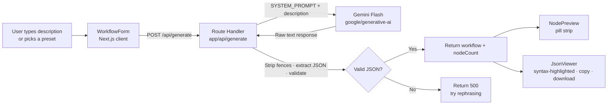

# n8n Workflow Generator

> Describe an automation in plain English — get importable n8n JSON in seconds.

[](https://nextjs.org)
[](https://typescriptlang.org)
[](https://aistudio.google.com)
[](LICENSE)

---

## What it does

- **Plain-English → n8n JSON** — Describe any automation; Gemini Flash generates a structurally valid n8n workflow JSON with correct node types, positions, and connections — ready to paste into n8n's Import dialog.
- **6 one-click presets** — Built-in templates for the most common patterns: daily Hacker News digest, webhook fan-out to Slack + Sheets, lead-capture to Notion, uptime monitor, Sheets → WhatsApp, and file-processor pipelines.
- **Live node-pill preview** — Every workflow renders a horizontal strip of labelled node pills so you can sanity-check the structure before opening the JSON.
- **Copy or download** — A syntax-highlighted viewer with one-click Copy JSON and a direct `workflow.json` file download.

---

## Architecture



---

## Tech Stack

| Layer | Technology |
|---|---|
| Framework | Next.js 16 (App Router) |
| Language | TypeScript 5 |
| Styling | Tailwind CSS 4 |
| AI model | Google Gemini Flash (`gemini-flash-latest`) |
| AI SDK | `@google/generative-ai` 0.24 |
| Runtime | Node.js (server-side API route) |

---

## Getting Started

### Prerequisites

- Node.js 18+
- A free Gemini API key — [aistudio.google.com/app/apikey](https://aistudio.google.com/app/apikey)

### Install

```bash
git clone https://github.com/pun33th45/n8n-workflow-generator.git
cd n8n-workflow-generator
npm install
```

### Configure

```bash
# Create .env.local in the project root
echo "GEMINI_API_KEY=your_key_here" > .env.local
```

### Run

```bash
npm run dev
```

Open [http://localhost:3000](http://localhost:3000).

### Import into n8n

1. Copy the generated JSON or download `workflow.json`
2. In n8n: **Add Workflow → Import from JSON**
3. Paste or upload the file
4. Add your credentials to each node and activate

---

## Project Structure

```
├── app/
│   ├── page.tsx                    # Main UI — two-column layout
│   ├── layout.tsx                  # Root layout + Syne font
│   └── api/generate/route.ts       # POST handler → Gemini → JSON
├── components/
│   ├── WorkflowForm.tsx            # Textarea + 6 preset buttons
│   ├── NodePreview.tsx             # Node pill strip renderer
│   └── JsonViewer.tsx              # Syntax-highlighted JSON + copy/download
├── lib/
│   ├── prompt.ts                   # System prompt (20 valid node types, connection rules)
│   └── n8n-types.ts                # N8nWorkflow · N8nNode · N8nConnection types
├── public/screenshots/             # UI screenshots
└── docs/                           # Demo GIF placeholder (add yours here)
```

---

## Roadmap

- [ ] **Workflow validation** — Parse the connections graph and flag orphaned or disconnected nodes before returning the JSON
- [ ] **n8n Cloud import** — Use the n8n public API to push generated workflows directly to a connected n8n instance
- [ ] **Generation history** — Persist the last 10 generated workflows in `localStorage` for quick retrieval and comparison

---

## Author

**Puneeth Raj** — AI Engineer · Full-Stack Developer

[](https://puneeth-dev.vercel.app)
[](https://linkedin.com/in/puneeth-raj-774506211/)
[](https://github.com/pun33th45)
